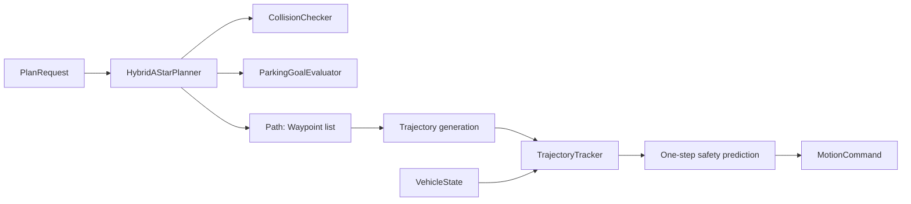

# ADAS Stack Architecture

This document covers only `adas_stack/`: portable C++ parking behavior that
can later live behind a vehicle middleware adapter. It deliberately has no
knowledge of TCP, JSON, Python, scenario files, or rendering. Those concerns
are documented in the [simulation bridge](SIM_BRIDGE_ARCHITECTURE.md) and
[simulator](SIMULATOR_ARCHITECTURE.md) guides.

## Public Boundary

`ParkingAdasStack` is the vehicle-facing facade:

```cpp
void reset(const PlanRequest& request);
MotionCommand command(const VehicleState& state);
```

`PlanRequest` supplies vehicle parameters, world bounds, obstacles, goal-slot
footprint, and the initial pose. `command()` returns only longitudinal
acceleration in m/s^2 and front mid-axle steering angle in radians.

## Module Map

| Area | Key files | Responsibility |
| --- | --- | --- |
| Domain | `domain/types.hpp` | Vehicle-neutral data: poses, waypoints, requests, obstacles, diagnostics, and commands. A `Waypoint` is the one motion artifact shared by planning, tracking, and external adapters. |
| Common | `common/math.*` | Angle, clamp, and kinematic-bicycle integration helpers. |
| Common | `common/footprint_geometry.*` | Vehicle and obstacle footprints plus convex-polygon operations. It is shared so collision and goal semantics cannot drift. |
| Planning | `planning/collision_checker.*` | Safety only: bounds and inflated-footprint collision checks. |
| Planning | `planning/parking_goal_evaluator.*` | Completion only: whole uninflated vehicle must be inside the goal slot and within its heading tolerance. |
| Planning | `planning/hybrid_a_star.*` | Forward/reverse kinematic search, collision-safe expansion, and the provisional-prefix fallback. |
| Planning | `planning/reeds_shepp_connector.*` | Builds and validates low-speed final connections from canonical forward/reverse arc and straight-segment words. |
| Stack | `planning/parking_adas_stack.cpp`, `stack/parking_adas_stack.hpp` | Orchestrates planning, trajectory construction, tracking, safety prediction, and replan requests. |
| Control | `control/trajectory_tracker.*` | Direction-aware low-speed tracking, gear-change stops, and divergence/stall detection. |

## Internal Flow



The path, generated trajectory, tracker input, and externally reported motion
all use the same `Waypoint` schema: pose, direction, curvature, target speed,
and gear-change marker. There is no separate visualization path inside the
ADAS stack.

## Geometry and Success Semantics

The rear axle is the vehicle reference pose. `footprint_geometry` turns it
into the four vehicle corners using the configured wheelbase, overhangs, and
width.

- `CollisionChecker` inflates that footprint by a configured clearance when
  deciding whether a candidate is safe.
- `ParkingGoalEvaluator` uses the real, uninflated footprint to decide whether
  the complete vehicle is in the slot and the heading is acceptable.

Keeping these as two collaborators is intentional: collision avoidance and
parking success have different questions, thresholds, and callers. Neither
should carry hidden rules for the other.

World bounds are carried explicitly in `PlanRequest`; they are not encoded as
synthetic obstacles. This avoids a boundary-wall convention leaking into
planning.

## Planner and Tracker Behavior

`HybridAStarPlanner` expands forward and reverse bicycle-model primitives and
checks the full vehicle footprint after propagation. Near the target it asks
`ReedsSheppConnector` for the lowest-cost collision-free candidate it finds from
left/right maximum-curvature arcs and straight segments, including gear
changes. It first spends its budget on a complete, slot-valid route. If it
cannot finish, it may return its best safe frontier path as a provisional
trajectory. The stack tracks that exact trajectory and lets the tracker request
a fresh plan at its end, after divergence, a stall, or predicted collision
risk.

The terminal handoff starts within 3 m of the target and can evaluate several
candidate search nodes. This lets the connector reject colliding local routes
without turning the first near-goal node into a single point of failure.

Trajectory generation preserves the planner's collision-checked poses and
curvatures, then assigns direction-aware low-speed targets and stops at gear
changes. `TrajectoryTracker` computes bounded desired steering with
direction-aware look-ahead and heading feedback, and requests a new plan when
terminal pose recovery stalls.

## Contributor Guide

### Add or replace a planner

1. Work in `adas_stack/planning/` and preserve `PlanRequest -> vector<Waypoint>`.
2. Call `CollisionChecker` for every propagated candidate.
3. Use `ParkingGoalEvaluator` for terminal acceptance; do not add goal rules to
   collision code.
4. Keep propagation consistent with the existing C++ bicycle helper.
5. Add focused C++ coverage and run the model-parity test.

### Change tracking

1. Work in `control/trajectory_tracker.*`.
2. Preserve the acceleration/front-steering command contract.
3. Exercise forward, reverse, gear-change, divergence, and stall paths.
4. Keep replan decisions in the ADAS stack, never in an adapter.

### Current improvement opportunities

- Migrate scalar start fields in `PlanRequest` to a `Pose start` once the
  external contract can make that coherent change.

## Build and Tests

```powershell
cmake -S . -B build
cmake --build build --config Release
ctest --test-dir build -C Release --output-on-failure
```

`tests/cpp/model_parity_test.cpp` verifies bicycle-model parity.
`tests/cpp/functional_components_test.cpp` covers the stack's planner,
geometry, goal evaluator, tracker, and protocol-independent behavior.
