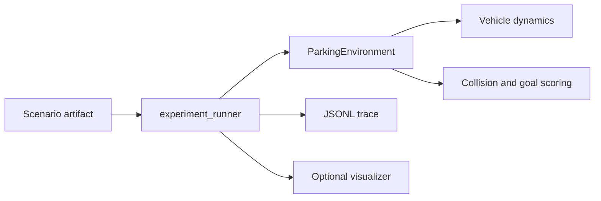

# Simulator Architecture

This document covers only `simulator/`: the Python environment that owns
scenario artifacts, authoritative vehicle dynamics, collision and success
scoring, experiments, traces, and optional rendering. It calls the local
adapter described in the [simulation bridge](SIM_BRIDGE_ARCHITECTURE.md); it
does not own ADAS planning or tracking policy.

## Runtime Responsibilities



The simulator accepts only longitudinal acceleration and front mid-axle
steering angle. It limits those commands using its actuator model, advances the
authoritative bicycle model, and evaluates outcome from the true vehicle
footprint.

## Module Map

| File or package | Responsibility |
| --- | --- |
| `experiment_runner.py` | Headless experiment lifecycle: selects a scenario and stack, starts the adapter, exchanges state/command messages, writes traces, and optionally renders. |
| `adas_stack_catalog.py` | Resolves the selected stack command from `catalogs/adas_stacks.json`; this is the future UI dropdown source. |
| `config_loader.py`, `config.json` | Simulator parameters and default runtime configuration. |
| `simulation/environment.py` | Scenario reset, simulation step, collision checks, and whole-car-in-slot success semantics. |
| `simulation/vehicle.py` | Vehicle dimensions, actuator limits, velocity limits, and kinematic bicycle update. |
| `simulation/kinematics.py` | Shared Python footprint and kinematic operations. |
| `simulation/controller.py`, `commands.py` | Input command DTOs and actuator limiting at the simulator boundary. |
| `simulation/parking_lot.py` | Perpendicular, parallel, and angled parking geometry. |
| `simulation/scenarios/` | Scenario model, factories, parked cars, and JSON artifact loading/saving. |
| `simulation/challenge.py` | Catalog-suite and slot-selection helpers. |
| `simulation/visualization/` | Optional inspection views; rendering is not required for fast catalog tests. |

## Scenarios and Artifacts

Scenario JSON files are reusable experiment inputs under `artifacts/scenarios/`.
They describe lot geometry, static obstacles, slots, ego state, and the goal
slot. Use `scripts/generate_parking_scenario.py` to generate an artifact, then
review and version it before using it in a suite.

Keep quick deterministic cases in `artifacts/scenarios/smoke/` and broader or
slower coverage in `artifacts/scenarios/benchmark/`. Generated run output goes
to ignored `artifacts/traces/` JSONL files.

## Run and Diagnose

Run the full catalog headlessly for fast feedback:

```powershell
python -m simulator.experiment_runner --adas-stack reference_parking --scenario-suite all --port 0
```

Inspect a single case with visualisation and a trace:

```powershell
python -m simulator.experiment_runner `
  --adas-stack reference_parking `
  --scenario-artifact artifacts/scenarios/smoke/empty_perpendicular.json `
  --render `
  --trace-dir artifacts/traces `
  --port 0
```

Read a trace in this order: `reset`, planning diagnostics, trajectory updates,
commands and state transitions, then the final result. That separates planner,
tracking, bridge, and simulator failures without making rendering part of the
debug loop.

## Simulator Change Rules

1. Keep vehicle physics authoritative here and update the C++ parity test when
   the bicycle model changes.
2. Keep success evaluation separate from command limiting and collision
   detection where possible.
3. Make scenario assumptions explicit in the artifact schema, never hidden in
   a planner or runner.
4. Add Python unit tests for simulator contracts and run a headless scenario
   after changes to physics, scoring, or scenarios.
