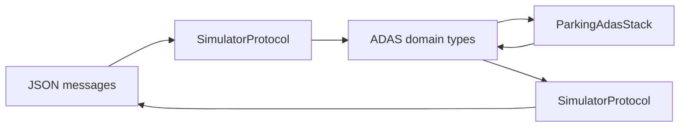
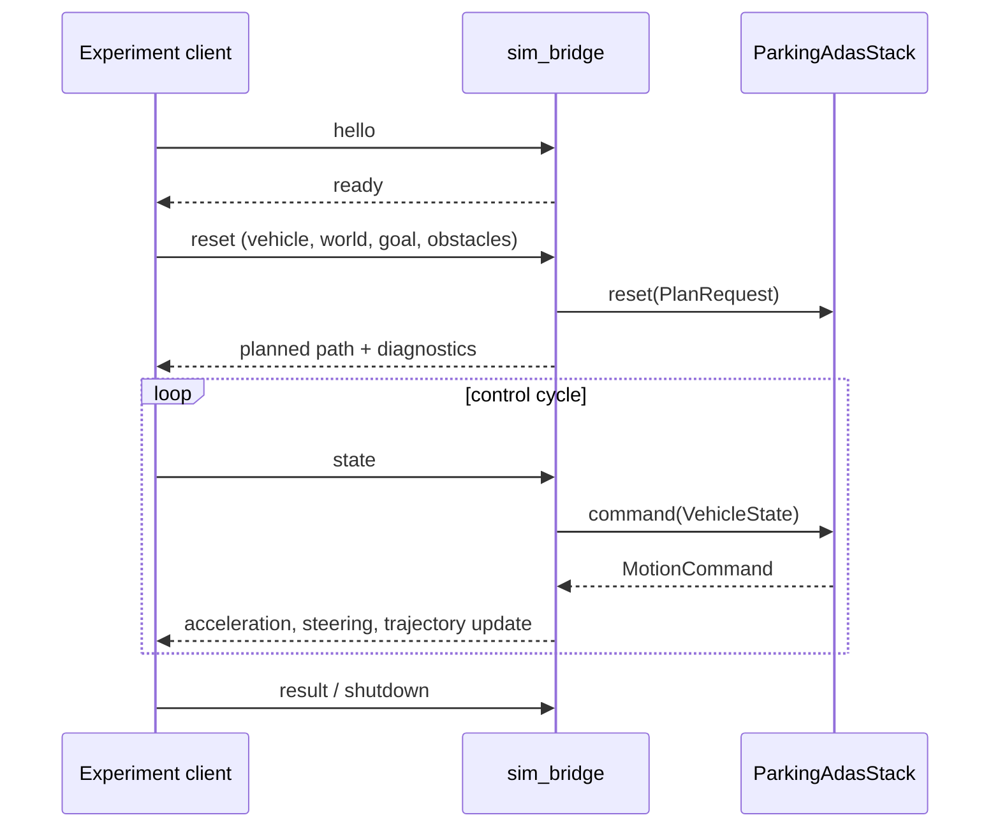

# Simulation Bridge Architecture

This document covers only `sim_bridge/`: the C++ adapter that translates the
local experiment protocol into ADAS domain types. It owns transport and JSON
translation, but no parking behavior or simulation physics. See the
[ADAS stack](ADAS_STACK_ARCHITECTURE.md) and [simulator](SIMULATOR_ARCHITECTURE.md)
documents for those responsibilities.

## Boundary

The bridge connects to one local experiment session using newline-delimited
JSON over TCP. Its job is deliberately narrow:

The bridge must not choose maneuvers, alter trajectories, perform collision
checks, or decide a parking result. It passes the stack's command and planned
waypoints through faithfully.

## Module Map

| File or area | Responsibility |
| --- | --- |
| `src/app/main.cpp` | Process entry point and message dispatcher. Owns a `ParkingAdasStack` for the session. |
| `cli.*` | Parses bridge process options such as TCP host and port. |
| `transport/tcp_client.*` | Connects, reads, and writes newline-delimited transport frames. |
| `protocol/json_fields.*` | Minimal dependency-free JSON field reading utilities. |
| `protocol/simulator_protocol.*` | Converts reset and vehicle-state messages to ADAS types; serializes acknowledgements, diagnostics, path updates, and commands. |

## Message Lifecycle

## Protocol Change Rules

1. Change parsing and serialization together in `simulator_protocol.*`.
2. Make the matching client-side change in the simulator runner.
3. Preserve units: metres, radians, seconds, metres per second, and metres per
   second squared.
4. Do not recreate planner-derived paths or apply control-law changes here.
5. Add a narrow C++ protocol test and run an end-to-end experiment trace.

The bridge is a replaceable adapter. A future ECU, ROS, or vehicle middleware
adapter should map the same ADAS domain contract without inheriting TCP/JSON
implementation details from this directory.
