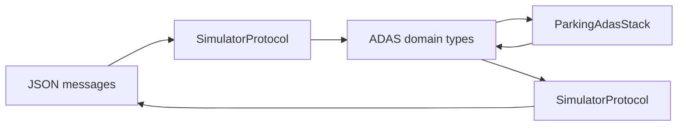
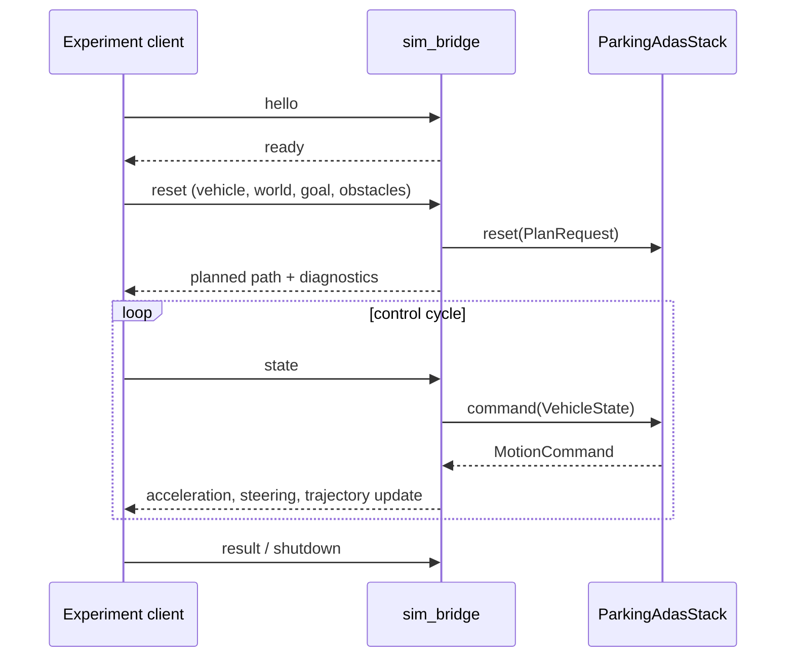

# Simulation Bridge Architecture

This document covers only `sim_bridge/`: the C++ adapter that translates the
local experiment protocol into ADAS domain types. It owns transport and JSON
translation, but no parking behavior or simulation physics. See the
[ADAS stack](ADAS_STACK_ARCHITECTURE.md) and [simulator](SIMULATOR_ARCHITECTURE.md)
documents for those responsibilities.

## Boundary

The bridge connects to one local experiment session using newline-delimited
JSON over TCP. Its job is deliberately narrow:

The bridge must not choose maneuvers, alter trajectories, perform collision
checks, or decide a parking result. It passes the stack's command and planned
waypoints through faithfully.

## Module Map

| File or area | Responsibility |
| --- | --- |
| `src/app/main.cpp` | Process entry point and message dispatcher. Owns a `ParkingAdasStack` for the session. |
| `cli.*` | Parses bridge process options such as TCP host and port. |
| `transport/tcp_client.*` | Connects, reads, and writes newline-delimited transport frames with bounded buffering. |
| `protocol/json_fields.*` | Parses JSON and validates field presence and types using nlohmann/json. |
| `protocol/simulator_protocol.*` | Converts validated reset and vehicle-state messages to ADAS types and serializes responses as JSON. |

The bridge uses the header-only nlohmann/json 3.11.3 library. CMake prefers an
installed package and otherwise fetches the version-pinned source archive with a
SHA-256 check. The TCP frame limit defaults to 1 MiB and can be changed with
`--max-frame-size <bytes>`; the limit applies to both received and sent frames,
excluding the terminating newline.

Reset messages require `start`, `start_heading`, and either `goal` or
`goal_pose`. State messages require `position`, `heading`, and `velocity`, in
the top-level object or the nested `state` object emitted by the simulator.
Vehicle and simulation configuration fields remain optional and retain their
domain defaults when omitted. If a field is present with the wrong JSON type,
or a required value is missing, parsing returns an explicit error.

## Message Lifecycle

## Protocol Change Rules

1. Change parsing and serialization together in `simulator_protocol.*`.
2. Make the matching client-side change in the simulator runner.
3. Preserve units: metres, radians, seconds, metres per second, and metres per
   second squared.
4. Do not recreate planner-derived paths or apply control-law changes here.
5. Add a narrow C++ protocol test and run an end-to-end experiment trace.

Outgoing response strings are serialized by the JSON library, so error text and
diagnostic strings are escaped as required by JSON. TCP reads use chunked socket
I/O while retaining any bytes beyond the current newline for the next frame.
EOF with no buffered bytes is a normal disconnect; EOF with a partial frame and
frames above the configured limit are explicit transport errors.

The bridge is a replaceable adapter. A future ECU, ROS, or vehicle middleware
adapter should map the same ADAS domain contract without inheriting TCP/JSON
implementation details from this directory.
